# CodexPet: All-in-One AI Desktop Companion & Quota Monitor
### *Lightweight Desktop Floating Widget Auto-Synchronizing Codex, Google Antigravity & WorkBuddy*

[-blue.svg)]()
[](https://dotnet.microsoft.com/)
[]()
[]()
[](LICENSE)
[]()
[](mailto:moyunxuan0@gmail.com)

---

## 📌 项目简介 (Overview)

**CodexPet (Codex Pet Lite)** 是一款专为 AI 辅助编程开发者量身打造的**轻量级桌面灵动伴侣与多平台状态仪表盘（Desktop Pet & Floating Widget）**。

无需在浏览器、控制台终端与各个 IDE 之间来回切换查看配额与任务进度，CodexPet 以极低资源开销实时自动同步并聚合监控三大核心 AI 编程环境：
1. **OpenAI Codex CLI**
2. **Google Antigravity Language Server**
3. **WorkBuddy AI Platform**

从 5 小时滚动配额倒计时、30 天活跃热力图、本月 Token 消耗走势、会话实时调用 Skill，到生动可爱的交互式桌宠小人情绪反馈，CodexPet 为你一览无余地优雅呈现。

---

## 🖼 视觉预览 (Screenshots)

### 1. 核心视图矩阵 (Core Views)
| 悬浮仪表盘主视图 | Codex 额度与活跃会话 | Antigravity 状态与配额 | WorkBuddy 平台与 Agent |
|:---:|:---:|:---:|:---:|
| 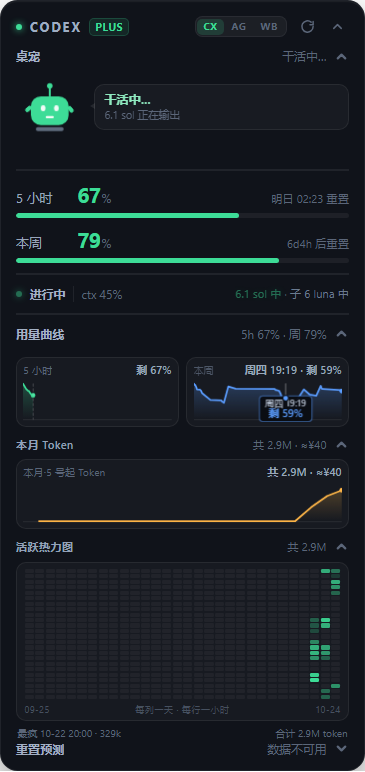 | 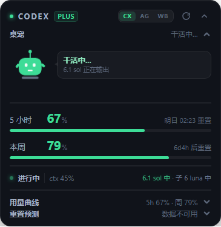 | 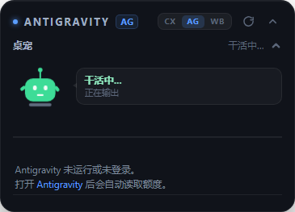 | 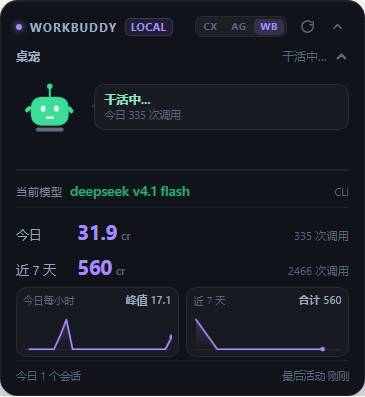 |

### 2. 深度时序分析与多维图表 (Analytics & Heatmap)
| 30 天 × 24 小时 活跃热力图 | 5小时 / 本周 / 本月 Token 消耗趋势曲线 |
|:---:|:---:|
| 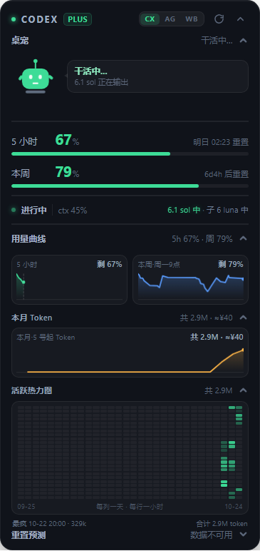 | 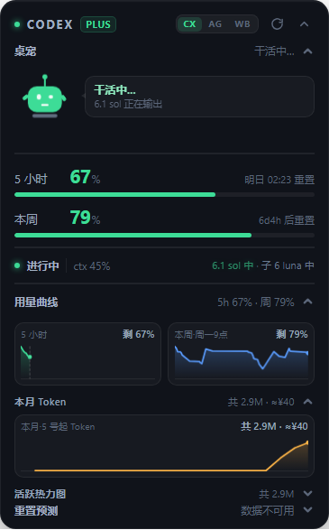 |

### 3. 灵动桌宠伴侣情绪与交互 (Desktop Pet Companion)
| 桌宠小人多种动态情绪状态 | 极简收起与极小占用模式 | 原生深色右键菜单 |
|:---:|:---:|:---:|
|  |  | 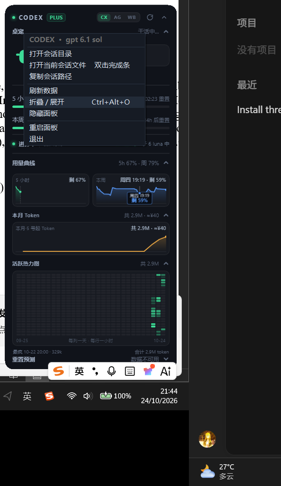 |

| 额度告急 · 抱头预警 | 连续工作 · 递咖啡关怀 | 凌晨深夜 · 打瞌睡 | 摸头互动 · 害羞腮红 |
|:---:|:---:|:---:|:---:|
| 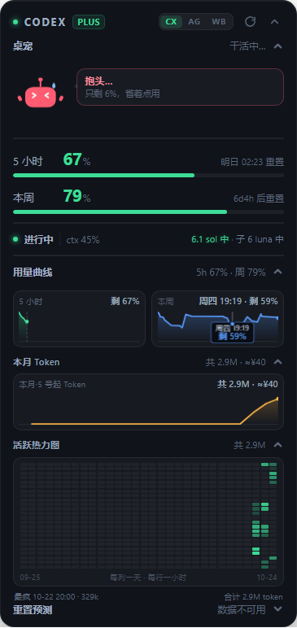 | 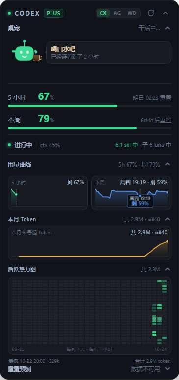 | 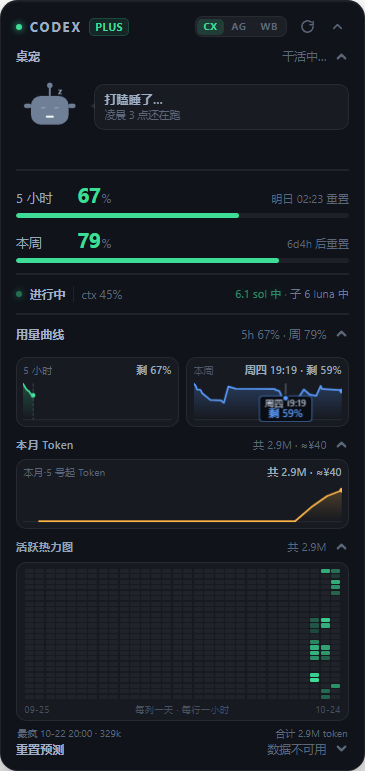 | 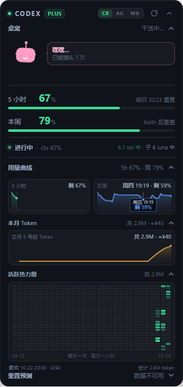 |

---

## ✨ 核心特性 (Key Features)

### 1. 🤖 灵动交互式桌宠小人 (Interactive Desktop Pet)
- **多状态情绪状态机**：
  - **待命 / 闲置 (Idle)**：轻巧头部浮动动画，静默守护编程状态。
  - **低配额抱头警戒 (Hug/Warning)**：当 5 小时配额跌至警戒线时抱头委屈，提示合理分配消耗。
  - **深夜打瞌睡 (Sleep/ZZZ)**：凌晨时段自动开启打瞌睡动效与冒泡文字。
  - **长时间工作递咖啡 (Coffee Break)**：连续工作超过 2 小时贴心递上热咖啡，关怀开发者健康。
  - **点击互动害羞 (Shy/Petted)**：鼠标单击桌宠小人触发摸头动态、害羞腮红与逗趣随机台词。
  - **任务完成喜悦反馈 (Done/Success)**：后台任务完成时同步欢呼。
- **独立折叠面板**：支持将桌宠小人一键折叠收拢，只保留简要状态标签，空间随心定制。

### 2. 🌟 三合一全自动多平台实时同步 (Tri-Platform Synchronization)
- **OpenAI Codex CLI 深度追踪**：
  - **双周期额度监控**：实时追踪 5 小时滚动窗口与本周用量窗口（剩余百分比、已用量、重置倒计时）。
  - **重置时间预测模型**：内置回退与步长预测算法，智能推测下一次配额完全刷新的准确时刻。
  - **活跃工作区与上下文感知**：实时读取当前会话路径（CWD）、活动模型、思考深度（Effort）、上下文窗口占用百分比（Context Window %）及运行中的 Subagent。
  - **实时 Skill 动态捕获**：实时嗅探当前会话中调用的 Skill 工具，并在卡片上以彩色药丸标签高亮展示。
- **Google Antigravity 本地语言服务自动嗅探**：
  - **零配置端口嗅探**：后台自动嗅探本地 Antigravity Language Server 端口（`12370 ~ 12380` 及新版端口）与会话 CSRF 令牌。
  - **多模型配额矩阵**：实时获取 Gemini 2.5 Flash / Pro 等主力模型的剩余调用次数与重置时间。
  - **双通道积分消耗**：实时展示 Prompt Credits 与 Flow Credits 消耗与剩余余量。
- **WorkBuddy 平台深度联动**：
  - 自动扫描本地 `~/.workbuddy/projects` 活跃工作区。
  - 统计今日消耗积分（Today Credit）、周消耗积分（Week Credit）、请求次数（Requests）及活跃会话数。
  - 实时绘制 **24 小时逐小时消耗曲线** 与 **7 天逐日消耗走势图**，同步展示调用的技能。

### 3. 📊 多维数据洞察：活跃热力图与本月消耗走势 (Analytics)
- **30 天 × 24 小时活跃热力图**：
  - 逐小时聚合统计本地 Token 产出，直观分析开发者每日高频写码时间分布及工作峰值时段。
  - 增量持久化缓存设计（`codex-heat.json`），即便扫描海量历史 rollout 文件亦可瞬间完成渲染。
- **本月累计 Token 消耗走势**：
  - 以每月 5 号配额重置日为计费锚点，自动累加绘制月度累计消耗平滑折线。
- **Token 成本估算模型**：
  - 支持在配置文件中自定义每百万 Output Token 美元单价与汇率，实时将用量折算为实际成本。

### 4. 🪟 极致优雅的桌面交互与快捷操作 (Desktop UX & Shortcuts)
- **全局一键折叠 & 系统热键**：
  - 随时按下全局快捷键 **`Ctrl + Alt + P`**，一键在完整仪表盘与极简顶栏状态间切换。
- **会话快速直达**：
  - 任务完成提醒横幅（Done bar）支持**双击直接定位并用默认编辑器打开对应的会话记录文件（rollout / transcript）**，单击快速切到对应 Agent 视图。
- **原生深色右键菜单**：
  - 全新设计的 `DarkMenuColors` 深色上下文菜单，彻底告别系统刺眼的白色原生弹窗，与亚克力半透明暗黑卡片融为一体。
- **圆角透明亚克力卡片与记忆吸附**：
  - 无边框现代设计，自适应 Windows 高 DPI 屏幕缩放（`96 ~ 192 DPI`），多显示器智能防越界重置，自由拖拽并记忆摆放坐标。
- **零负担极低资源占用**：
  - 基于 C# .NET 8 WinForms + Microsoft Edge WebView2 构建，空闲时 CPU 占用近乎 0%，内存占用极低。

---

## 🕹 界面操作与交互指南 (Interactive Guide)

| 操作方式 | 功能说明 |
|---|---|
| **`Ctrl + Alt + P`** *(全局热键)* | **全局一键折叠 / 展开卡片**（无需激活窗口即可快速收起或唤出面板）。 |
| **鼠标左键按住拖拽** | 按住卡片顶部或空白区域可在屏幕任意位置自由移动，自动持久化坐标。 |
| **点击桌宠小人** | 触发摸头互动动画，切换害羞腮红与随机趣味对话。 |
| **折叠桌宠小人** | 点击“桌宠”折叠栏，收起小人形象，仅保留紧凑状态标签。 |
| **顶部标签切换 (`Codex` / `AG` / `WB`)** | 瞬时切换三大监控源：Codex 模式、Antigravity 模式与 WorkBuddy 模式。 |
| **顶部折叠按钮 (`▲` / `▼`)** | 将卡片收缩为极简顶栏模式，不遮挡任何工作区域。 |
| **完成横幅单击** | 切换并聚焦至刚刚完成任务的对应 Agent 视图。 |
| **完成横幅双击** | **直接在系统编辑器中打开该任务的完整会话记录文件**（方便排查推理与输出）。 |
| **趋势曲线折叠** | 展开/收起 5 小时、本周用量走势图。 |
| **本月 Token / 热力图折叠** | 展开/收起本月累计 Token 曲线与 30 天 × 24 小时活跃热力图。 |
| **托盘左键单击** | 快速隐藏或唤出桌面悬浮窗。 |
| **托盘 / 卡片右键菜单** | 立即强制刷新、打开官方配额页、配置开机自启、创建桌面快捷方式、退出程序。 |

---

## 🚀 使用方法 (Usage Instructions)

### 方式一：免安装直接运行 (推荐日常使用)
本项目已在 `publish/` 目录下提供了完整的独立免安装发布包，无需配置开发环境即可开箱即用：
1. **下载或克隆仓库**：
   ```bash
   git clone https://github.com/MOYUNXUAN4/CodexPet.git
   cd CodexPet
   ```
2. **启动桌宠**：
   - 进入 `publish/` 文件夹。
   - 双击直接运行 **`CodexPet.exe`**。
   - *（Windows 10/11 系统均自带 WebView2 Runtime；如提示缺少可根据微软官方引导安装）*。
3. **设置开机自启与快捷方式**：
   - 运行后右键点击任务栏右下角小托盘图标或卡片菜单。
   - 勾选 **“开机自启”** 即可在每次开机时自动在桌面为你守护额度。
   - 点击 **“创建桌面快捷方式”** 可在桌面快速生成一键直达图标。

---

### 方式二：从源码编译 (适合二次开发与定制)

#### 环境要求
- **操作系统**：Windows 10 (Build 1809+) 或 Windows 11 (64-bit)
- **.NET SDK**：[.NET 8.0 SDK](https://dotnet.microsoft.com/download/dotnet/8.0) 或更高版本
- **开发工具**：Visual Studio 2022 / JetBrains Rider / VS Code

#### 编译与发布步骤
```bash
# 1. 克隆代码仓库
git clone https://github.com/MOYUNXUAN4/CodexPet.git
cd CodexPet

# 2. 还原 NuGet 依赖
dotnet restore

# 3. 运行调试
dotnet run

# 4. 生成独立发布版 (Release)
dotnet publish -c Release -o ./publish
```

---

## ⚙️ 配置文件与数据路径 (Storage & Config)

CodexPet 遵循 Windows 标准数据规范，所有本地持久化配置均独立安全存储于用户目录：

- **程序配置**：`%APPDATA%\codex-pet\codex-pet-config.json`（保存窗口坐标、折叠状态、上次模式、成本估算单价与汇率）
- **用量时序走势**：`%APPDATA%\codex-pet\codex-history.json`（存储配额时序采样数据）
- **活跃热力图缓存**：`%APPDATA%\codex-pet\codex-heat.json`（存储按小时聚合的 Token 增量缓存）
- **日志诊断输出**：`%TEMP%\codex-pet.log`（记录轮询生命周期、端口嗅探与错误诊断）

---

## 👨‍💻 作者与开源许可 (Author & License)

- **作者 / 开发者 (Author)**：**MOYUNXUAN**
- **联系邮箱 (Email)**：[moyunxuan0@gmail.com](mailto:moyunxuan0@gmail.com)
- **开源协议 (License)**：本项目采用 [MIT License](LICENSE) 开源。欢迎自由使用、学习、修改与提交 Pull Request！
- **GitHub 仓库**：[https://github.com/MOYUNXUAN4/CodexPet](https://github.com/MOYUNXUAN4/CodexPet)
