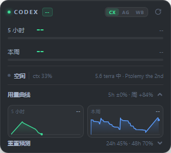
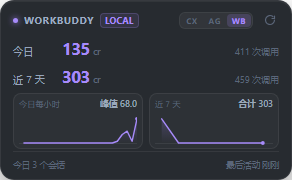
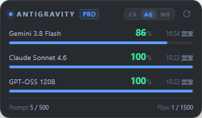

# CodexPet: All-in-One AI Desktop Companion & Quota Monitor
### *Lightweight Desktop Floating Widget Auto-Synchronizing Codex, Google Antigravity & WorkBuddy*

[-blue.svg)]()
[](https://dotnet.microsoft.com/)
[]()
[](LICENSE)
[]()

---

## 📌 项目简介 (Overview)

**CodexPet (Codex Pet Lite)** 是一款专为 AI 辅助编程开发者打造的**轻量级、无感桌面悬浮伴侣与多平台状态仪表盘（Desktop Pet & Floating Widget）**。

无需在浏览器、终端与各个 IDE 之间来回切换查看额度与任务状态，CodexPet 能够在 Windows 桌面上以极低资源开销实时自动同步并聚合监控三大核心 AI 编程工具：
1. **OpenAI Codex CLI**
2. **Google Antigravity Language Server**
3. **WorkBuddy AI Platform**

无论是 5 小时滚动额度倒计时、Token 消耗预测、当前活动会话与上下文长度，还是多 Agent 任务完成提醒，CodexPet 都能为你一览无余地优雅呈现。

---

## 🖼 视觉预览 (Screenshots)

| 悬浮仪表盘主视图 | Codex 额度与会话监控 | Antigravity 状态与配额 |
|:---:|:---:|:---:|
|  |  |  |

| WorkBuddy 消耗与活跃 Agent | 24小时 / 7天 消耗趋势曲线 |
|:---:|:---:|
|  |  |

---

## ✨ 核心特性 (Key Features)

### 1. 🌟 三合一全自动多平台实时同步 (Tri-Platform Synchronization)
- **OpenAI Codex CLI 智能追踪**：
  - **双周期额度监控**：实时追踪 5 小时滚动用量窗口（剩余百分比、已用量、重置倒计时）及本周用量窗口。
  - **重置时间预测模型**：内置回退与步长预测算法，智能推测下一次配额完全刷新的时间。
  - **活跃工作区感知**：实时读取当前会话路径（CWD）、活动模型、思考深度（Effort）、上下文窗口占用百分比（Context Window %）及运行中的 Subagent。
  - **完成提醒（Done Notification）**：Codex 终端完成输出时触发浮窗脉冲动效。
- **Google Antigravity 本地语言服务自动捕获**：
  - **零配置端口嗅探**：后台自动探测本地 Antigravity Language Server 端口（`12370 ~ 12380`）与会话 CSRF 令牌。
  - **多模型配额矩阵**：实时获取 Gemini 2.5 Flash / Pro 等主力模型的剩余调用次数与重置时间。
  - **双通道积分消耗**：实时展示 Prompt Credits 与 Flow Credits 消耗与剩余余量。
- **WorkBuddy 平台深度联动**：
  - 自动扫描本地 `~/.workbuddy/projects` 活跃工作区。
  - 统计今日消耗积分（Today Credit）、周消耗积分（Week Credit）、请求次数（Requests）及活跃会话数。
  - 实时绘制 **24 小时逐小时消耗曲线** 与 **7 天逐日消耗走势图**。

### 2. 🪟 极致优雅的桌面交互体验 (Desktop Pet UX)
- **圆角透明亚克力卡片**：无边框现代设计，自适应 Windows 高 DPI 屏幕缩放（`96 ~ 192 DPI`），多显示器智能防越界重置。
- **自由拖拽与记忆吸附**：鼠标按住卡片任意位置即可自由拖动定位，重启后自动记忆上次摆放坐标。
- **紧凑药丸 / 完整仪表盘双形态**：一键切换极简药丸微缩模式与全量详细卡片模式。
- **系统托盘深度集成（System Tray）**：
  - 托盘图标悬停即可在 Tooltip 中直观看到当前 5 小时与每周剩余额度百分比（例如：`Codex 5h 82% · 周 95%`）。
  - 右键菜单集成“显示/隐藏”、“立即强制刷新”、“一键直达官方额度页”、“创建桌面快捷方式”、“开机自启开关”。
- **零负担极低资源占用**：
  - 基于 C# .NET 8 WinForms + Microsoft Edge WebView2 构建。
  - 后台静默轮询与文件变化事件监听，空闲时 CPU 占用近乎 0%，内存占用极低。

---

## 🚀 使用方法 (Usage Instructions)

### 方式一：免安装直接运行 (推荐日常使用)
本项目已在 `publish/` 目录下提供了完整的独立免安装发布包，无需配置开发环境即可开箱即用：
1. **下载或克隆仓库**：
   ```bash
   git clone https://github.com/MOYUNXUAN4/CodexPet.git
   cd CodexPet
   ```
2. **启动桌宠**：
   - 进入 `publish/` 文件夹。
   - 双击直接运行 **`CodexPet.exe`**。
   - *（Windows 10/11 系统均自带 WebView2 Runtime；如提示缺少可根据微软官方引导安装）*。
3. **设置开机自启与快捷方式**：
   - 运行后右键点击任务栏右下角小托盘图标。
   - 勾选 **“开机自启”** 即可在每次开机时自动在桌面右下角为你守护额度。
   - 点击 **“创建桌面快捷方式”** 可在桌面快速生成一键直达图标。

---

### 方式二：从源码编译 (适合二次开发与定制)

#### 环境要求
- **操作系统**：Windows 10 (Build 1809+) 或 Windows 11 (64-bit)
- **.NET SDK**：[.NET 8.0 SDK](https://dotnet.microsoft.com/download/dotnet/8.0) 或更高版本
- **开发工具**：Visual Studio 2022 / JetBrains Rider / VS Code

#### 编译与发布步骤
```bash
# 1. 克隆代码仓库
git clone https://github.com/MOYUNXUAN4/CodexPet.git
cd CodexPet

# 2. 还原 NuGet 依赖
dotnet restore

# 3. 运行调试
dotnet run

# 4. 生成独立发布版 (Release)
dotnet publish -c Release -r win-x64 --self-contained false -o ./publish
```

---

## 🕹 界面操作指南 (Interactive Guide)

| 操作方式 | 功能说明 |
|---|---|
| **鼠标左键按住拖拽** | 按住卡片顶部或空白区域，可在屏幕任意位置自由移动，自动保存摆放坐标。 |
| **顶部标签切换 (`Codex` / `AG` / `WB`)** | 瞬时切换三大监控源：Codex 模式、Antigravity 模式与 WorkBuddy 模式。 |
| **右侧展开/折叠按钮** | 切换简易状态药丸（占地极小）与完整详细数据面板。 |
| **折线图趋势按钮** | 展开/收起 24 小时逐小时及 7 日用量趋势平滑折线图。 |
| **托盘左键单击** | 快速隐藏或唤出桌面悬浮窗。 |
| **托盘右键菜单** | 立即刷新数据、打开官方网页设置、配置开机自启、创建桌面快捷方式、退出程序。 |

---

## ⚙️ 配置文件与数据路径 (Storage & Config)

CodexPet 遵循 Windows 标准数据规范，所有本地持久化配置均独立安全存储于用户目录：

- **程序配置**：`%APPDATA%\codex-pet\codex-pet-config.json`（保存窗口坐标、展开状态、上次模式）
- **用量历史走势**：`%APPDATA%\codex-pet\codex-history.json`（存储时序采样用于绘制趋势图）
- **日志诊断输出**：`%TEMP%\codex-pet.log`（记录轮询生命周期、端口嗅探与错误诊断）

---

## 👨‍💻 作者与开源许可 (Author & License)

- **作者 / 开发者 (Author)**：**QI YUXUAN (QI YUXAUN)**
- **开源协议 (License)**：本项目采用 [MIT License](LICENSE) 开源。欢迎自由使用、学习、修改与提交 Pull Request！
- **GitHub 仓库**：[https://github.com/MOYUNXUAN4/CodexPet](https://github.com/MOYUNXUAN4/CodexPet)
